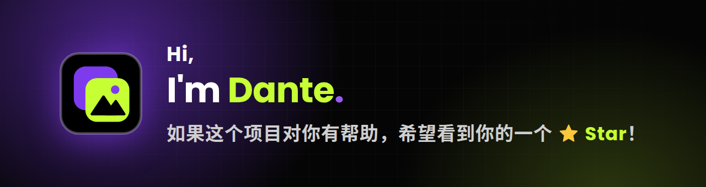

<div align="center">


# ImgBed Sidekick • 图床搭搭

**让你的 ImgBed 链接鲜活呈现 · Bring your ImgBed links to life.**

将[图床](#-简介)里的图片、视频、音乐链接，打造成专属于你个人的多媒体展示站 • 部署在 Cloudflare Pages • 零服务器

🖥️[Demo 演示](https://ibsidekick.dpdns.org) • 密码 88111 • [部署](#-部署到-cloudflare-pages)

[](https://pages.cloudflare.com/)
[](https://react.dev/)
[](https://vitejs.dev/)
[](https://developers.cloudflare.com/kv/)
[](https://tailwindcss.com/)
[](https://github.com/video-dev/hls.js/)
[](./LICENSE)


</div>

---

## 📖 简介

ImgBed Sidekick 是一个基于 React (Vite) + Tailwind CSS 的前端项目 · 配合 Cloudflare Pages Functions + KV 提供轻量后端

你只需要把图床（CloudFlare ImgBed、R2、各类对象存储……）里的**文件链接**贴进去即可

**推荐搭配** [CloudFlare-ImgBed](https://github.com/MarSeventh/CloudFlare-ImgBed) 项目 • 通过其[一键链接](https://cfbed.sanyue.de/guide/features.html)复制 • 轻松接入

| 页面 | 说明 |
| --- | --- |
| 🏠 **Home** | 站点首页，入口卡片 |
| 🖼️ **Gallery** | 图片瀑布流，大图浏览、标签筛选、随机排序 |
| 🎬 **Vlogs** | 视频瀑布流，内置播放器，支持 `.mp4` 与 `.m3u8`（HLS） |
| 🎵 **Music** | 「黑胶」风格音乐播放器，自动匹配歌词、收藏云同步 |

🎯链接不用改代码：在页面上的 **「URL设置」** 里直接编辑、保存，数据存在 Cloudflare KV 。

---

## ✨ 功能特性

### 🔗 链接管理
- **在线编辑**：Gallery / Vlogs / Music 各自独立的「URL设置」弹窗，保存到 KV 后即时生效
- **管理密码保护**：写入、清除、恢复默认都必须验证 `ADMIN_PASSWORD`
- **三级读取**：KV → 浏览器缓存 → `links/*.txt`（默认值/兜底，删除也不影响构建）
- **一键恢复 / 清除**：「恢复为默认(txt)」「清除内容」只修改文本框，点「保存」后才生效
- **容错解析**：空行和以 `#` 开头的注释行自动忽略；同一个链接重复写，只显示一份
- **默认/自定义标签**：默认标签（取自链接路径）；自定义标签（用 `标签名[ … ]` 放入链接）详见 [链接格式](#-链接格式)

### 🖼️ Gallery 画廊
- 瀑布流排版，图片真实宽高缓存到浏览器，二次打开不再跳动
- 大图浏览：左右切换、键盘方向键、`Esc` 退出
- 标签筛选、列数调节、名称/随机排序
- 网格卡片标签跟随当前筛选；在「全部」下，有自定义标签的显示「第一个自定义标签 +其余标签数」
- 快捷键 `R` 随机排序；支持滚轮切换大图
- 「DIY记忆」：每个功能键可单独选择是否记住上次的设置

### 🎬 Vlogs 视频
- 同时支持 `.mp4` 与 `.m3u8`（Chrome / Firefox / Edge 通过 `hls.js` 播放）
- 视频瀑布流 + 内置播放器：进度、音量、倍速、网页全屏 / 原生全屏
- 搜索只匹配「视频标题」，多关键词用空格分隔（需全部命中）
- 标签筛选、列数调节（手机 2 列 / 平板 3 列自动适配）、滚轮切换
- 网格卡片标签规则同 Gallery
- 键盘控制：`空格` 播放/暂停、`←` `→` 快退/快进 5 秒（配合 Shift 为 15 秒）、`↑` `↓` 音量、`PageUp` `PageDown` 上一个/下一个

### 🎵 Music 音乐
- 黑胶唱片界面，播放模式：列表循环 / 单曲循环 / 随机播放 / 播完停止
- 自动歌词：按歌名（+歌手）匹配带时间轴的歌词，支持全屏歌词，结果缓存在本地
- 倍速播放、睡眠定时（15 / 30 / 45 / 60 分钟或播完当前歌曲）
- **收藏云同步**：收藏列表存 KV
- 小彩蛋（仅桌面端）：歌曲链接的上一级目录若是 `CN/HK/TW/US/UK/JP/KR`，唱片旁会出现对应地区的剪影地图
- 快捷键：
  | 按键 | 功能 | 按键 | 功能 |
  | --- | --- | --- | --- |
  | `空格` | 播放 / 暂停 | `M` | 静音 |
  | `←` `→` | 快退 / 快进 5 秒（配合 `Shift` 为 15 秒） | `L` | 收藏当前歌曲 |
  | `↑` `↓` | 音量 ± 5% | `R` | 切换播放模式 |
  | `PageUp` `PageDown` | 上一首 / 下一首 | `/` | 聚焦搜索框 |

### 🔐 访问保护（可选）
- `functions/_middleware.js` 提供整站登录：未登录的请求拿不到任何页面、脚本或图片
- 无状态 HMAC 签名 Cookie（有效期 15 天），无需 KV；修改密码或密钥后所有已登录设备立即失效
- 密码错误延迟返回，恒定时间比较，登录跳转地址仅限站内路径
- Home 右上角自动出现「退出登录」
- 登录过期自动检测并刷新

---

## 🚀 部署到 Cloudflare Pages

> 全程在浏览器里完成，不需要本地安装任何东西。

### 1. Fork 本仓库
点击右上角 **Fork**，或直接把代码上传到你自己的 GitHub 仓库。

### 2. 创建 Pages 项目
Cloudflare 控制台 → **Workers & Pages** → **创建** → **Pages** → **连接到 Git**，选择你的仓库，构建配置如下：

| 配置项 | 值 |
| --- | --- |
| 框架预设 | 无 / React (Vite) 均可 |
| 构建命令 | `npm run build` |
| 构建输出目录 | `dist` |

### 3. 创建并绑定 KV
1. **Workers & Pages → KV → 创建命名空间**（名称随意，例如 `ImgBed_Sidekick`）
2. 进入你的 Pages 项目 → **设置 → 绑定 → 添加 → KV 命名空间**
3. **变量名必须填写 `LINKS_KV`**，选择刚创建的命名空间

### 4. 设置环境变量
进入 **设置 → 环境变量**，按下表添加：

| 变量名 | 是否必需 | 说明 |
| --- | :---: | --- |
| `ADMIN_PASSWORD` | 必需✅ | 「URL设置」管理密码。未设置时一律禁止写入。建议 16 位以上字符串 |
| `SITE_PASSWORD` | 可选 | 站点访问密码。建议 16 位以上 |
| `SESSION_SECRET` | 可选 | 登录签名密钥，**至少 32 位**随机字符串，不要和密码相同 |
| `VITE_SITE_NAME` | 可选 | 站点名称，统一用于 Home 标题、Music 标题栏与系统媒体控制、网页标题、登录页 |
| `VITE_FOOTER_TEXT` | 可选 | 页脚内容 |
| `VITE_FOOTER_CREDIT` | 可选 | 设为 `false` 则不显示页脚跳转和版本号 |

> ⚠️ **访问密码的两个变量（`SITE_PASSWORD`+`SESSION_SECRET`）要成对设置**：两个都不设 = 不启用登录；只设其中一个 = 拒绝所有访问（防止缺失设置）

### 5. 重新部署
**绑定和环境变量都要重新部署后才会生效**：回到「部署」页，对最新一次部署点击「重试部署」，或向仓库提交一次新的 commit

### 6. 添加你的链接
打开站点：进入 Gallery / Vlogs / Music 任一页面，点击 **「URL设置」** → 输入管理密码 → 粘贴链接 → **保存**

---

## 📝 链接格式

<details>
<summary><b>👉点击展开</b></summary>

每行一个链接，不需要引号和逗号，空行与 `#` 开头的行会被忽略。

**Gallery（图片）**
```text
# 图片链接，标签取自上一级路径名（以下是 IMGSpace）
https://your-imgbed.example.com/file/IMGSpace/Demo.jpg
```

**Vlogs（视频：支持 .mp4 / .m3u8）**
```text
# .mp4：标签取自上一级路径名；.m3u8：标签取自上两级路径名（以下均是 VlogSpace）
https://your-imgbed.example.com/file/VlogSpace/Demo.mp4
https://your-imgbed.example.com/file/VlogSpace/Demo/Demo.m3u8
```

**Music（音乐：三种写法任选）**
```text
# 1. 仅链接（歌名取自链接文件名）
https://your-imgbed.example.com/file/MusicSpace/Demo.mp3
# 2. 歌名 | 链接
Demo | https://your-imgbed.example.com/file/MusicSpace/Demo.mp3
# 3. 歌名 | 歌手 | 链接
Closer (80s Remix) | The Chainsmokers | https://your-imgbed.example.com/file/MusicSpace/Demo.mp3
```

**自定义标签（Gallery / Vlogs / Music 通用，可选）**

默认标签取自链接的路径；想按自己的分类筛选，可以写成 `标签名[` 开头、`]` 结尾的块，块里每行一个链接（Music 里每行仍可用上面三种写法）：

```text
我的收藏[
https://your-imgbed.example.com/file/VlogSpace/Demo1.mp4
https://your-imgbed.example.com/file/VlogSpace/Demo2.mp4
]

# 也可以把 ] 直接接在最后一个链接后面，或整块写在一行：标签名[链接]
```

规则：

- **只写在块里的链接，只属于这个自定义标签**，不带默认标签；同一个链接在块外也写了一行，才同时带默认标签
- 同一个链接可以放进多个标签块（如「我的收藏」「安静模式」），它在「全部」里只出现一份，每个标签里也只出现一份
- 自定义标签与默认标签同名时合并成一个；标签名请避开 `All IMG`、`All Vlogs`、`All Music`
- 块里的 `#` 注释行会被忽略；没写 `]` 的块会一直算到文件末尾
- 链接本身以 `]` 结尾时，在块里会被当成块的结束
- 在 `links/*.txt` 和「URL设置」里都可以这样写

</details>

---

## 🖼️ 用本仓库直接存放媒体文件（不推荐-受限于Github/Cloudflare）

文件放进 `public/` 即可，链接写成根路径：

- `public/Demo.jpg` → `/Demo.jpg`
- `public/img/Demo.jpg` → `/img/Demo.jpg`

> Cloudflare Pages 限制：**单个文件小于 25MB，文件总数不超过 2 万个**；文件越多，构建与部署越慢。大文件建议放图床。

---

## 💻 本地开发

<details>
<summary><b>点击展开</b></summary>
  
```bash
# 1. 安装依赖
npm install

# 2. 仅预览前端界面（没有 Functions，「URL设置」「收藏同步」「访问密码」不可用，链接读取 links/*.txt）
npm run dev

# 3. 完整本地调试（含 Functions + KV）
npm run build
npx wrangler pages dev dist --kv LINKS_KV --binding ADMIN_PASSWORD=your-admin-password
# 需要测试访问密码时，再追加：
#   --binding SITE_PASSWORD=your-site-password --binding SESSION_SECRET=at-least-32-chars-random-string
```

环境要求：Node.js ≥ 18 • npm ≥ 9

</details>

---

## 🔌 后端接口

<details>
<summary><b>点击展开</b></summary>
  
所有接口均运行在 Cloudflare Pages Functions，站点开启访问密码时同样会被登录拦截。

| 接口 | 方法 | 说明 |
| --- | --- | --- |
| `/api/links/{gallery\|vlogs\|music}` | `GET` | 读取 KV 中保存的链接，`{ text: string \| null }`（`null` 表示还没有数据） |
| | `POST` | 仅验证管理密码，不读写数据（请求头 `X-Admin-Password`） |
| | `PUT` | 保存链接（需管理密码，请求体 `{ text }`，上限 1MB） |
| | `DELETE` | 删除 KV 数据，页面回退读取 `links/*.txt`（需管理密码） |
| `/api/likes` | `GET` / `PUT` | Music 收藏同步（最多 5000 首，如需调整更改 `MAX_ITEMS` 和 `MAX_BYTES` 即可）。站点开了访问密码时已登录即可写入，否则需管理密码 |
| `/api/session` | `GET` | 告知页面站点是否启用了访问密码（决定是否显示「退出登录」） |

KV 键名：`links:gallery`、`links:vlogs`、`links:music`、`likes:music`

</details>

---

## 🛡️ 安全说明

- 写入类接口强制校验管理密码，并拒绝跨站提交（校验 `Origin` / `Sec-Fetch-Site`）
- 密码比较使用 HMAC + 恒定时间比较，错误后延迟 1 秒返回，减缓暴力破解
- 登录 Cookie 为 `HttpOnly; Secure; SameSite=Lax`，登录页带严格 CSP 与 `X-Frame-Options: DENY`
- 请使用足够长的随机字符串作为 `ADMIN_PASSWORD`、`SITE_PASSWORD`、`SESSION_SECRET`
- 「Theme」、「DIY记忆」与歌词缓存只存在浏览器 `localStorage`，不跨设备

---

## 📂 目录结构

<details>
<summary><b>点击展开</b></summary>

```text
ImgBed-Sidekick/
├── public/                      # 静态资源（favicon 等）
├── docs/                        # README 用图
├── functions/                   # Cloudflare Pages Functions（后端）
│   ├── _middleware.js           # 站点访问密码（可选）
│   └── api/
│       ├── links/
│       │   └── [name].js        # 链接读写：GET / POST / PUT / DELETE
│       ├── likes.js             # Music 收藏同步：GET / PUT
│       └── session.js           # 告诉页面站点是否启用了访问密码
├── src/
│   ├── components/
│   │   ├── Navbar.jsx           # 导航栏组件
│   │   ├── LinksEditor.jsx      # 「URL设置」
│   │   ├── LogoutButton.jsx
│   │   ├── ImgPlaceholder.jsx   # 占位图组件
│   │   ├── ThemeDial.jsx
│   │   └── ThemeButton.jsx
│   ├── lib/
│   │   ├── authExpired.js       # 登录过期检测与自动刷新
│   │   ├── customTags.js        # 自定义标签解析（标签名[ … ]）与去重
│   │   ├── linkFiles.js         # 读取 links/*.txt 作为默认链接
│   │   ├── likesSync.js         # Music 收藏同步逻辑
│   │   ├── noMouseFocus.js
│   │   └── siteConfig.js
│   ├── pages/                   # Home / Gallery / Vlogs / Music
│   ├── App.jsx                  # 根组件
│   ├── index.css                # 全局样式
│   ├── themes.css               # 主题色板（CSS 变量）
│   ├── themes.js
│   └── main.jsx                 # 应用入口
├── links/                       # 默认链接 / 兜底（KV 里没有数据时才用，删除也不影响构建）
│   ├── GalleryURL.txt
│   ├── VlogsURL.txt
│   └── MusicURL.txt
├── .gitignore
├── index.html
├── LICENSE
├── README.md
├── package.json
├── package-lock.json
├── postcss.config.js
├── tailwind.config.js
└── vite.config.js
```

</details>

---

## ❓ 常见问题

<details>
<summary><b>保存链接时提示「kv_not_bound」？</b></summary>

没有绑定 KV，或变量名不是 `LINKS_KV`。绑定后记得重新部署。
</details>

<details>
<summary><b>「URL设置」数据来源：`links/*.txt`（默认）与 `KV` 的区别？</b></summary>

| | `links/*.txt` | Cloudflare KV |
|---|---|---|
| **数据位置** | 打包进（项目仓库 links/… ）前端代码，随部署发布 | 存在 Cloudflare 的 KV 命名空间里，页面运行时通过 /api/links/… 读取 |
| **修改方式** | 改文件 → 提交代码 → 等（push）Cloudflare Pages重新构建部署 | 在页面「URL设置」里直接编辑保存，立即生效，无需部署 |
| **前提条件** | 无 | 绑定 KV（变量名必须是 `LINKS_KV`）并设置 `ADMIN_PASSWORD` |
| **优点** | 不依赖后端，本地预览也能用<br>随代码进 Git，方便备份和回滚<br>读取最快，没有额外请求 | 编辑便捷，改链接不用动代码<br>接口受站点访问密码保护，未登录读不到<br>可一键恢复默认（删除 KV 数据后回读 txt） |
| **缺点** | 链接公开在前端代码里<br>（项目仓库 Public 情况下） | 多一次网络请求，保存后其它地区可能有短暂延迟<br>（此说法是相对性，实际体验几乎无差异感）<br>数据不在 Git 里，如需备份需自行操作 |
| **适合场景** | 链接基本不变，或不想配置 KV<br>（建议项目仓库改为 Private） | 链接经常变，随时随地直接更改 |
</details>

<details>
<summary><b>整个站点打不开 / 一直显示拒绝访问？</b></summary>

`SITE_PASSWORD` 与 `SESSION_SECRET` 只设了其中一个。要么两个都设（ `SESSION_SECRET` 必须 至少 32 位随机字符串），要么两个都删除。
</details>

<details>
<summary><b>修改了环境变量但页面没变化？</b></summary>

环境变量和 KV 绑定都需要**重新部署**后才生效；`VITE_` 开头的变量是构建时注入的，改完必须重新构建。
</details>

<details>
<summary><b>.m3u8 视频无法播放？</b></summary>

确认视频源允许跨域访问（CORS），且分片地址可以访问；Safari 使用原生播放，其他浏览器使用 `hls.js`。
</details>

<details>
<summary><b>想换站点图标？</b></summary>

修改 `public/favicon.svg`（并同步更新 `functions/_middleware.js` 中内嵌的登录页图标 `FAVICON_SVG`，登录页不能引用外部文件），以及 `favicon.ico`、`apple-touch-icon.png`。
</details>

<details>
<summary><b>歌词来源？</b></summary>

[LRCLIB](https://github.com/tranxuanthang/lrclib) API 服务支持
</details>

---

## 📄 许可证

本项目使用 [MIT License](./LICENSE) 

<div align="center">



</div>
