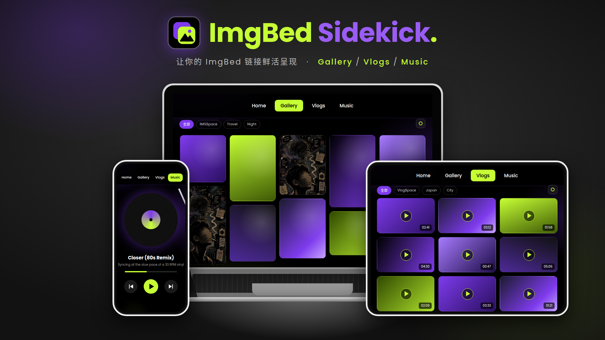

# ImgBed Sidekick • 图床搭搭

**让你的 ImgBed 链接鲜活呈现 · Bring your ImgBed links to life.**

将[图床](#-简介)里的图片、视频、音乐链接，打造成专属于你个人的多媒体展示站 • 部署在 Cloudflare Pages • 零服务器

🖥️[Demo 演示](https://ibsidekick.dpdns.org) • 密码 88111 • [部署](https://github.com/EternityDT/ImgBed-Sidekick)

